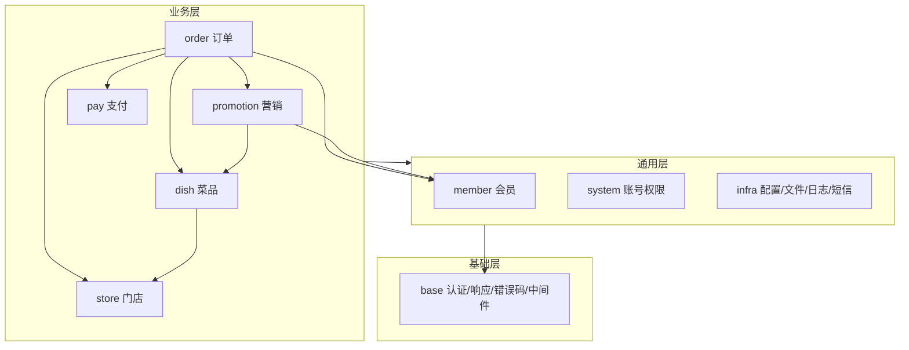

# 02 · 系统架构设计

> 上一份：[01 需求规格](./01-需求规格说明书.md)｜下一份：[03 数据模型](./03-数据模型设计.md)

**一句话**：一个进程、五个业务模块、四个复用模块，模块间是包调用而不是网络调用。

---

## 1. 形态

- 后端：单一 Go 进程，监听一个端口，前后端分离部署。
- 前端：管理后台（内含 POS / KDS 路由）、顾客端小程序、骑手端、商户端；当前只有管理后台落地。
- 不引入注册中心、网关、RPC、分布式事务。

| 取舍 | 微服务 | 本方案 | 结论 |
| --- | --- | --- | --- |
| 部署 | 多服务、多套配置 | 一个二进制 | 门店量级下运维成本更低 |
| 调用 | RPC + 服务发现 | 包调用 | 无网络开销 |
| 事务 | 最终一致 | 本地事务 | 一致性更容易 |
| 边界 | 天然按服务 | 靠目录与评审 | 需 Code Review |
| 扩容 | 按服务 | 整体多实例 | 单品牌规模足够 |

---

## 2. 模块分层

**依赖铁律**

1. 只允许上层依赖下层，`base` 最底，谁都能用。
2. 跨模块只调 **Service**，禁止读别的模块的表、Repository、Model。
3. 唯一例外：`member` 调 `infra` 发短信。

---

## 3. 模块职责

| 模块 | 状态 | 职责 |
| --- | --- | --- |
| base | 已有 | 认证、统一响应、错误码、参数、中间件、基础类型 |
| system | 已有 | 账号、角色、菜单权限、字典、登录与操作日志 |
| infra | 已有 | 参数、文件、文件配置、API 日志、短信 |
| member | 已有 | 会员、等级、积分、签到、标签、分组、地址、社交登录 |
| store | 新建 | 门店组织树、桌台区域、桌台、门店员工 |
| dish | 新建 | 分类、SPU/SKU、加料组、门店可售与门店价 |
| order | 新建 | 购物车、订单、结账、KDS 出餐、库存 |
| promotion | 新建 | 券模板、用户券、活动 |
| pay | 新建 | 支付单、退款、储值钱包 |

---

## 4. 一次请求的链路

1. 全局日志中间件记录访问信息，不阻塞响应。
2. 认证中间件校验令牌：后台写登录者身份，C 端写会员身份，两者不通用。
3. 后台接口再校验权限点；C 端只看会员身份。
4. Controller 只做取参与校验，业务在 Service，数据访问在 Repository。
5. 统一返回 `{code, msg, data}`，HTTP 状态码恒为 200，业务结果看 `code`。

**门店上下文**：门店级请求带门店标识，中间件校验当前用户是否可见该门店，
再写入请求上下文；Repository 统一按门店过滤，写操作由 Service 强制赋值，不信任前端。

---

## 5. 多门店在架构上的落点

| 落点 | 做法 |
| --- | --- |
| 组织树 | 门店表自引用父子关系，区分总部 / 大区 / 门店 |
| 门店上下文 | 请求级上下文，不跨 goroutine 自动传递，异步任务要显式带上 |
| 数据隔离 | 门店级表带门店字段，查询统一走同一个过滤入口 |
| 员工与门店 | 员工-门店关联表决定可见门店集合 |
| 跨店共享 | 会员、积分、券、钱包不带门店字段，天然全品牌通用 |

> 会员与钱包**刻意不带门店维度**，这就是「跨店通用」；订单、桌台、库存**必须带门店**，这就是「门店隔离」。

---

## 6. 运行与部署

- 无状态，可多实例；令牌与缓存走 Redis。
- 一期单库；主从读写分离可选。
- 定时任务随应用启动，多实例部署前必须加分布式锁。
- 本地开发需要 MySQL、Redis，前端各自起 dev server 并代理接口。

---

## 7. 风险与对策

| 风险 | 对策 |
| --- | --- |
| 模块边界被破坏 | 依赖评审 + 禁止跨模块访问数据层 |
| 门店越权 | 统一过滤入口 + 越权测试矩阵 |
| 支付回调丢失 | 定时补查 + 主动查单 |
| 库存超卖 | 缓存预扣 + 数据库条件扣减 + 定时校准 |
| 表结构漂移 | 所有结构变更走迁移并登记 |
