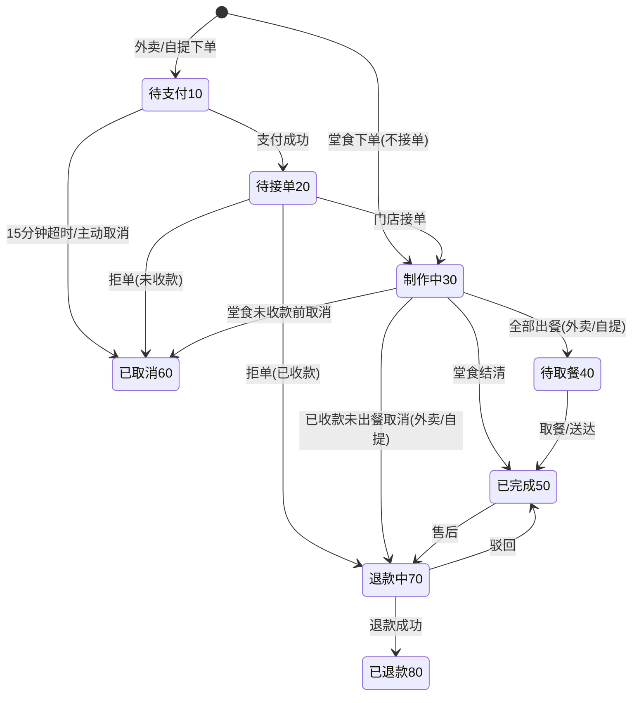

# 05 · 核心业务流程设计

> 上一份：[04 接口设计](./04-接口设计.md)｜下一份：[06 多门店能力](./06-多门店能力设计.md)

**一句话**：`status` 表达业务进度，`pay_status` 表达钱；堂食先做后付，外卖/自提先付后做。

---

## 1. 订单状态机

| 状态 | 含义 | 说明 |
| --- | --- | --- |
| 10 待支付 | 已下单未付款 | 仅外卖 / 自提 |
| 20 待接单 | 已付款等门店接单 | 仅外卖 / 自提 |
| 30 制作中 | 后厨制作 | **堂食的起始状态** |
| 40 待取餐 / 配送中 | 自提取餐、外卖配送 | 堂食不使用 |
| 50 已完成 | 取餐、送达、堂食结清 | |
| 60 已取消 | 超时或主动取消 | |
| 70 退款中 | 整单退款处理中 | |
| 80 已退款 | 整单退款完成 | |

**约束**

- 每次流转校验白名单，非法流转直接报错；并发事件导致的重复推进按「条件更新」跳过，不报错。
- 每次流转写订单日志，带操作人与原因。
- `pay_status` 只有未支付 / 已支付 / 已退款三个值，与 `status` 不混用。

---

## 2. 堂食（先做后付）

- 下单直接进入「制作中」，立即入后厨，不创建支付单。
- 同店同桌已有进行中订单时**并入**，不新建；明细记录点菜人，仅用于展示与对账。
- 桌台未清台前，**谁扫码谁可结清整桌**，也可只结一部分。
- 用完餐结账：首次收款才核销券、扣积分；全部结清后订单完成、桌台转「待清台」。
- 堂食不参与超时关单，靠结账与清台收尾。

---

## 3. 外卖与自提（先付后做）

| 环节 | 外卖 | 自提 |
| --- | --- | --- |
| 下单后 | 待支付，15 分钟未付关单 | 同左 |
| 支付后 | 待接单，入后厨 | 待接单，入后厨 |
| 履约 | 接单 → 制作 → 打包 → 骑手取送 → 完成 | 接单 → 制作 → 备餐完成 → 凭码取餐 |
| 特殊 | 校验配送范围、起送价、配送费、打包费 | 4~6 位取餐码，默认 2 小时有效 |

平台单从开放接口进入，需处理平台拒单超时（通常 5 分钟）。

---

## 4. 后厨出餐

- 一个订单只生成**一张出餐单**，整单一张卡；后厨不设「档口」层级（见 [19 §1](./19-KDS界面详细设计.md)、[24 §1](./24-自配送与骑手设计.md)）。
- 堂食下单即入厨，出餐单直接「制作中」；外卖/自提支付成功才入厨，先「待接单」。
- 全部接单 → 订单转「制作中」；全部出餐 → 外卖/自提转「待取餐/配送中」；堂食不流转。
- 加菜增量推送到出餐单；未出餐的退菜从出餐单移除。
- 超时预警阈值可配，超时高亮并通知店长。

---

## 5. 结账

| 场景 | 规则 |
| --- | --- |
| 一次结清 | 结账单 + 一张支付单，结清即完成 |
| 多次结账 | 每次一条结账单与支付单，明细归属对应结账单 |
| 优惠分摊 | 整单优惠按明细小计占比分摊；最后一批用「应付 − 已付」消尾差 |
| 组合支付 | 储值卡 + 第三方补差 |
| 拆单 | 按人或按项拆多笔（AA） |

---

## 6. 退款与逆向

**整单退款**（进入退款中 → 已退款）：

1. 发起退款并记录退款单；
2. 回滚库存；
3. 扣回已赠送积分与成长值；
4. 返还优惠券（未核销的解锁，已核销的恢复为未使用）；
5. 退回积分抵扣（仅已结算过才退）；
6. 释放活动名额；
7. 储值卡金额返还；
8. 报表冲销。

**部分退款**：不进入「退款中」，只退钱、扣减实付与按比例扣回赠送积分；
**不返还**券、**不退**积分抵扣、**不回滚**库存、**不释放**名额。

> 逆向补偿允许失败重试，按「本地任务表 + 定时重试」保证最终一致。

---

## 7. 券与积分

- 下单**锁定**券、记录积分抵扣额度；收款才核销与扣减；取消/超时/整单退款才返还。
- **加菜只适用于堂食进行中的订单**；外卖/自提支付后追加菜品需另下新单，避免已付订单金额变动。
- 加菜可以重新校验门槛、重算抵扣额（券仍在锁定态）。
- 部分退款不返还券与积分，避免「退一点钱拿回整张券」。
- 优惠计算顺序见 [07 §4](./07-会员与营销设计.md)。

---

## 8. 并发、幂等与定时任务

- **同桌合并**按「门店 + 桌台」加分布式锁，锁必须在事务提交后释放；抢锁失败短时自旋后报错。
- **下单幂等**靠请求唯一标识 + 唯一索引；**券状态流转**靠条件更新。
- 定时任务：超时关单、支付状态补查、券过期、等级重算、积分过期、门店日结、库存校准。
- 多实例部署前，所有定时任务必须加分布式锁。
