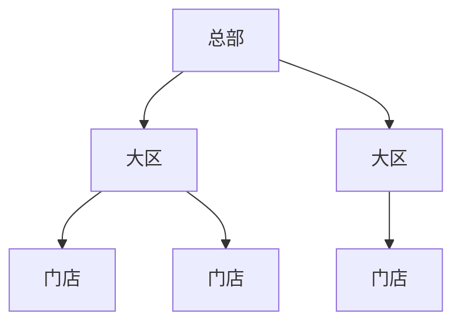

# 06 · 多门店能力设计

> 上一份：[05 核心业务流程](./05-核心业务流程设计.md)｜下一份：[07 会员与营销](./07-会员与营销设计.md)

**一句话**：数据分三层归属，门店级靠「门店字段 + 统一过滤 + 上下文校验」隔离，其余全品牌共享。

---

## 1. 组织层级

- 用**一张门店表**承载总部 / 大区 / 门店，靠类型字段区分、父子关系成树。
- 层级浅、节点少，便于统一维护权限与查询。
- 大区可选：没有大区的品牌，门店直接挂总部。

---

## 2. 数据归属（决定有没有门店字段）

| 类型 | 归属 | 隔离方式 | 示例 |
| --- | --- | --- | --- |
| 品牌级 | 无 | 共享，一次维护全店引用 | 菜品、规格、券模板、活动 |
| 门店级 | 门店 | 隔离，按店查询与写入 | 订单、桌台、库存、门店可售、门店价 |
| 用户级 | 会员 | 跨店共享，全品牌唯一账本 | 会员、积分、券、钱包 |

> 仓库没有多租户、没有部门，门店隔离 100% 自己承担。

---

## 3. 隔离怎么做

四层防护，任何一层都不能省：

1. **上下文**：门店级请求携带门店标识，中间件校验当前用户是否可见，再写入请求上下文。
2. **查询**：门店级查询统一走同一个过滤入口，自动追加门店条件。
3. **写入**：服务端强制写入门店，不信任前端传值。
4. **二次校验**：切店、跨店导出、门店员工操作前再校验一次。

**可见门店集合**：由员工-门店关联表决定；总部直属员工可见全部；结果缓存，权限变更时失效。
**异步任务**：请求上下文不跨 goroutine，队列与定时任务必须显式带上门店标识。
**C 端**：门店由参数或扫码结果显式传入，只校验营业状态，不校验员工可见性。

---

## 4. 配置继承与覆盖

规则：**品牌默认值 → 门店覆盖值**，没有覆盖就用默认。

| 配置 | 品牌默认 | 门店可覆盖 |
| --- | --- | --- |
| 商品可售 | 菜品上下架 | 门店上下架 |
| 商品价格 | 标准价、会员价 | 门店价、门店会员价（超出浮动区间需审批） |
| 营业时间 | 品牌建议 | 门店实际 |
| 配送规则 | 品牌模板 | 范围、起送价、配送费 |
| 自动接单 | 品牌默认 | 门店开关 |
| 会员等级 | 品牌统一 | **不可覆盖** |
| 券模板 | 品牌统一 | 门店专属券需总部审批 |

---

## 5. 菜单与价格

生成门店菜单的顺序：

1. 取全部上架菜品；
2. 过滤门店下架项；
3. 计算最终价（从高到低）：门店时段价 > 门店会员价（会员）> 门店价 > 品牌会员价（会员）> 品牌标准价；
4. 叠加沽清状态；
5. 按门店缓存，价格或可售变更时失效。

---

## 6. 库存

| 模式 | 说明 | 适用 |
| --- | --- | --- |
| 无限 | 不管数量 | 供应充足的标准品 |
| 每日限量 | 每天重置，售完沽清 | 招牌限量、每日鲜品 |
| 实时扣减 | 下单即扣，到 0 沽清 | 高价值、需精确管控 |

- 下单先预扣（缓存原子操作），再落库做条件扣减；两步都成功才算下单成功。
- 取消 / 超时回滚；定时任务以数据库为准校准缓存。
- 门店间调拨为后续能力，模型预留变动类型即可。

---

## 7. 跨店资产

会员、积分、券、钱包**不带门店字段**，天然跨店通用；消费门店记录在订单与流水中，用于业绩分摊。

| 资产 | 默认 | 可配置 |
| --- | --- | --- |
| 积分 | 全品牌通用 | 是否限门店 |
| 优惠券 | 按模板范围 | 全品牌 / 指定门店 / 指定商品 |
| 储值卡 | 全品牌通用 | 是否限充值门店 |
| 会员等级 | 品牌统一 | 不可配置 |

---

## 8. 权限与数据范围

- **功能权限**：沿用现有 RBAC，接口挂权限点。
- **数据范围**：由员工-门店关联表推导，分为全部 / 大区 / 指定门店 / 单店 / 本人五种。
- C 端天然按会员隔离，不涉及员工门店关系。
- 任何跨范围访问写操作日志，记录操作人、目标门店、接口与时间。

---

## 9. 门店生命周期

| 阶段 | 影响 |
| --- | --- |
| 筹备（装修） | 不可下单 |
| 试营业 | 不单独设状态：门店为「营业」，仅开放部分渠道 |
| 营业 | 正常经营 |
| 休息 | 停止接单，可预约 |
| 停业 | 保留历史，禁止新单 |

新店可通过「门店模板」继承标杆店的菜品可售、价格与配送配置。

---

## 10. 上线检查清单

- [ ] 门店级表都有门店字段，并建了以门店打头的索引？
- [ ] 门店级查询都走统一过滤入口？
- [ ] 写入的门店值由服务端赋值，而非前端传入？
- [ ] 队列与定时任务显式传递了门店标识？
- [ ] 总部跨店访问有审计？
- [ ] 会员、积分、券、钱包确认不带门店字段？
- [ ] 门店停业后，历史可查、新单被拦截？
