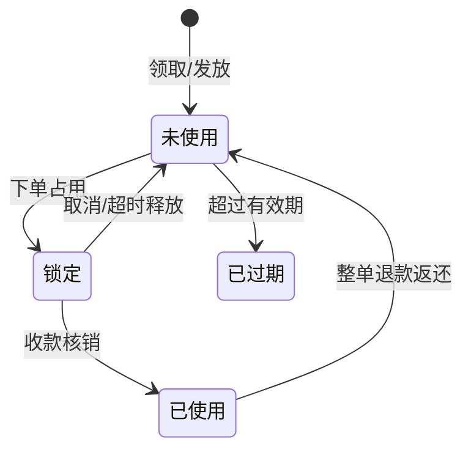

# 07 · 会员与营销设计

> 上一份：[06 多门店能力](./06-多门店能力设计.md)｜返回：[文档总览](./README.md)

**一句话**：会员体系直接用现成的，只做券、活动和钱包。

---

## 1. 能力来源

| 能力 | 来源 | 说明 |
| --- | --- | --- |
| 会员档案、登录、等级、成长值、积分、签到、标签、分组、地址 | 现有 member | 不重复开发 |
| 储值钱包 | 新建 pay | 仓库当前没有支付模块 |
| 优惠券、活动 | 新建 promotion | 本模块的全部新增工作 |
| 支付、退款 | 新建 pay | 订单收款的唯一通道 |

---

## 2. 会员

- 登录方式：社交快捷登录（已绑定才可用）、手机号验证码登录（不存在则自动注册）、社交绑定。
- 等级按成长值划分，规则全品牌统一，门店不可覆盖。
- 成长值随支付成功累计，等级只升不降；每日定时兜底重算。
- 消费积分在收款时发放或扣减；签到按档位即时发放积分与经验。
- 积分抵扣：固定兑换比例 + 单笔抵扣上限，比例与上限可配置。
- 积分与成长值只能通过会员模块的原子方法变更，业务模块不得直接更新。

---

## 3. 优惠券

**类型**：满减、折扣（可封顶）、单品、兑换、代金。

**适用范围**：全品牌 / 指定门店 / 指定商品；另有渠道限制（不限 / 仅线上 / 仅线下）。

**生命周期**：



- 状态流转必须条件更新，防并发重复使用。
- 门槛在加菜后可以重算，但券始终保持锁定态直到收款。
- 部分退款不返还券。

**发放方式**：主动领取（限每人张数）、消费返券、新人礼、定向发券、分享裂变（后续）。

---

## 4. 优惠计算顺序（唯一口径）

```
1. 菜品原价（门店时段价 / 门店会员价 / 门店价 / 会员价 / 标准价）
2. 单品级优惠（单品券、加价购）
3. 商品级活动（第二份半价、限时折扣）
4. 订单级活动（满减、套餐）
5. 优惠券
6. 积分抵扣
7. 储值卡抵扣
= 应付金额
```

每步产生明细并整体留档，供用户查看、客服核对、财务对账。

---

## 5. 活动引擎

| 玩法 | 说明 |
| --- | --- |
| 满减 | 阶梯满减 |
| 第二份半价 | 同款第二份折扣 |
| 限时折扣 | 指定时段折扣 |
| 套餐特惠 | 组合价低于单品之和 |
| 加价购 | 满额后加价换购 |

**判定顺序**：

1. 同类型互斥，只取优先级最高；
2. 排除组互斥；
3. 不可叠加的活动独占，生效即终止；
4. 可叠加的活动累加；
5. 名额已用完的跳过；
6. 累加不超过商品小计。

**名额**：按活动 + 周期计数；整个活动期一个周期键，每日活动按日期作键，跨天自动重置，无需定时清零。

---

## 6. 储值卡

- 品牌级资产，按会员唯一，跨店通用。
- 充值走统一支付渠道；充值档位可配置赠送金额。
- 消费扣减余额并写流水，流水记录消费门店，供门店间分摊。
- 一期单一余额；如需「本金 / 赠送」分离，后续加字段。

---

## 7. 扩展点

| 编号 | 事项 | 优先级 |
| --- | --- | --- |
| E-01 | 会员模块补只读查询（按 ID 取会员与余额） | P0 |
| E-02 | 支付成功后累计成长值并重算等级 | P0 |
| E-03 | 新建支付与钱包能力 | P0 |
| E-04 | 积分过期任务 | P2 |
| E-05 | 新会员注册发券 | P1 |

---

## 8. 风控

| 风险 | 对策 |
| --- | --- |
| 刷单薅羊毛 | 频次限制；新人券延迟生效 |
| 券超发 | 发行量原子扣减 + 条件更新 |
| 积分套现 | 不可提现，抵扣比例封顶 |
| 储值资金 | 资金入品牌商户号，大额退款审批 |
| 隐私合规 | 手机号脱敏，支持注销 |
