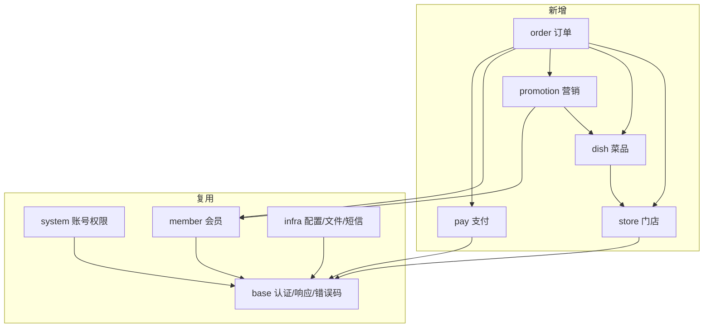

# 08 · eqray-flavor 框架适配设计

> 上一份：[07 会员与营销](./07-会员与营销设计.md)｜返回：[文档总览](./README.md)

**一句话**：账号、会员、文件、短信复用；门店、菜品、订单、营销、支付按同一分层新建。

---

## 1. 基线事实

| 事实 | 影响 |
| --- | --- |
| Go 单进程、单体多模块 | 模块间包调用，不引入 RPC / 网关 |
| 已有 base / system / infra / member | 直接复用，不改或轻改 |
| 没有多租户、没有部门 | 门店组织树与数据隔离必须自研 |
| **没有支付模块** | 支付、退款、钱包需要新建 |
| 没有代码生成器 | 新增 CRUD 照抄现有模块的写法 |
| 前端只有管理后台可用 | POS / KDS 先挂管理后台；顾客端、骑手端、商户端从占位目录建 |
| 雪花 ID、统一审计字段 | 表结构与序列化以仓库为准 |

---

## 2. 模块全景

| 模块 | 类型 | 职责 |
| --- | --- | --- |
| base | 复用 | 认证、响应、错误码、参数、中间件、基础类型 |
| system | 复用 | 账号、角色、菜单权限、字典、日志 |
| infra | 复用 | 参数、文件、API 日志、短信 |
| member | 复用 | 会员、等级、积分、签到、标签、分组、地址、社交登录 |
| store | 新建 | 门店组织树、桌台、门店员工 |
| dish | 新建 | 分类、菜品、规格、加料、门店可售与门店价 |
| order | 新建 | 购物车、订单、结账、KDS、库存 |
| promotion | 新建 | 券模板、用户券、活动 |
| pay | 新建 | 支付、退款、钱包 |

---

## 3. 复用清单

**直接复用**：后台登录与权限、菜单与按钮权限、字典、短信、社交登录、会员档案与等级、积分流水、
签到、标签与分组、地址、文件上传、定时任务、操作与 API 日志。

**需要轻改**：

| 事项 | 说明 |
| --- | --- |
| 会员只读查询 | 订单需要取会员昵称、手机号、余额 |
| 成长值流水 | 现有只有等级变更记录；需要逐笔流水时新增表 |
| 签到表名 | 仓库实际是「签到记录」，与旧设计名称不同，以仓库为准 |
| 会员注册发券 | 一期在注册流程内同步调用，二期改队列 |
| 字典预置 | 订单状态、订单类型、沽清原因等写入种子 |
| 门店过滤入口 | 由门店模块提供统一的查询过滤方法 |

**必须自研**：门店组织树、门店数据权限、门店上下文、员工-门店关系、商品体系、订单与出餐、券与活动、支付与钱包。

---

## 4. 门店权限落地

1. **组织树**：一张门店表自引用，区分总部 / 大区 / 门店。
2. **员工-门店**：关联表决定可见门店，结果缓存，变更后失效。
3. **上下文**：请求头携带门店，中间件校验可见性后写入请求上下文；不用全局变量。
4. **查询过滤**：门店级查询统一走同一个过滤入口；写入由 Service 强制赋值。
5. **越权审计**：总部跨店允许，但要记操作日志；越权统一返回固定错误码。

> 没有数据库拦截器，隔离靠「中间件 + 统一过滤 + 服务端赋值 + 越权测试」四重保证。

---

## 5. 新增模块必做

1. 建立 `store/dish/order/...` 模块目录，按接入端拆分管理端与 C 端。
2. 在模块聚合处注册路由，否则接口不生效。
3. 新增表用迁移，且必须在迁移注册表中登记；一表一个文件，种子单独一个文件。
4. 新增页面必须补菜单、权限点与字典种子，并授权给内置角色。
5. 除上传等自助接口外，每个接口挂权限点；写操作记操作日志。
6. 每个方法写中文文档注释：做什么、约束、入参、返回。

---

## 6. 错误码分段

| 模块 | 段 | 说明 |
| --- | --- | --- |
| infra | 001 | 已占用 |
| system | 002 | 已占用 |
| member | 003 | 已占用 |
| store | 004 | 门店、桌台、员工 |
| dish | 005 | 菜品、菜单 |
| order | 006 | 订单、出餐、库存 |
| promotion | 007 | 券、活动 |
| pay | 008 | 支付、退款、钱包 |

新增错误码前先看该模块错误码文件头的占用登记。

---

## 7. 落地顺序

1. **门店 + 菜品**：建表、种子、基础 CRUD，打通门店与菜单。
2. **支付最小闭环**：支付单、回调、退款、钱包基础表；没有它订单无法收款。
3. **订单**：下单 → 支付 → 回调 → 状态机，接入会员积分。
4. **KDS 与库存**。
5. **营销**：券与活动，接入钱包做储值。
6. **前端**：管理端页面、POS / KDS、顾客端。

---

## 8. 风险

| 风险 | 对策 |
| --- | --- |
| 门店越权 | 统一过滤 + 越权测试矩阵 + 上线检查清单 |
| 支付模块缺失 | 提到阶段二，先于下单闭环 |
| 会员表与旧设计不一致 | 以仓库表为准，实现前核对 |
| 无代码生成器 | 照抄现有模块，评审对比样板 |
| 定时任务重复执行 | 多实例前加分布式锁 |
| 前端只有管理端 | POS 先挂管理端，小程序从空目录初始化 |
